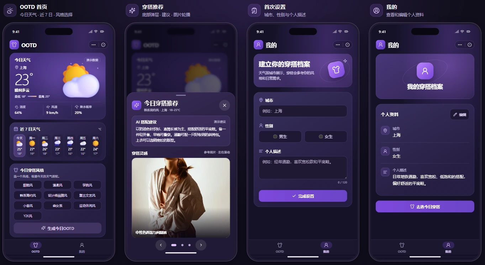

# OOTD MINi

一款把天气预报和每日穿搭建议放在一起的微信小程序。填写所在城市和穿搭偏好后，可以先看天气，再按今天想穿的风格获取搭配建议。仓库包含小程序源码和可单独运行的网页交互原型。

## 使用截图



图为运行中的网页原型，展示了从查看天气、选择风格到查看搭配建议的界面，以及首次设置和个人资料。

## 功能

| 功能 | 说明 |
| --- | --- |
| 今日天气 | 查看当前气温、天气状况、最高与最低气温、湿度、风速和降水概率。 |
| 近 7 日天气 | 在小程序中点选日期，上方卡片显示当天的天气和气温区间。点「今天」切回当前天气。 |
| 今日穿搭 | 根据资料中的性别提供对应的 10 种风格。选定风格后，推荐弹层会展示结合今日天气和个人偏好的搭配建议，以及三张可切换的参考照片。 |
| 首次设置与我的 | 首页在资料缺失时自动打开引导。城市、性别和个人描述保存在本地，可在「我的」查看和修改。 |

小程序通过 Express 后端读取 Coze 工作流的天气数据，网页原型使用内置示例。穿搭建议由本地规则生成，图片采用图库照片。

## 本地运行

### 天气后端

在仓库根目录使用 Node.js 22 或更新版本运行以下命令：

```powershell
cd server
npm ci
Copy-Item .env.example .env
```

在 `server/.env` 填写 `COZE_TOKEN` 和已发布工作流的 `COZE_WORKFLOW_ID`。城市入参默认为 `city`，可以通过 `COZE_CITY_PARAMETER` 修改。然后在 `server/` 运行 `npm start`，默认监听 `127.0.0.1:3000`。

接口为 `GET /api/weather?city=深圳`，后端调用[扣子执行工作流 API](https://docs.coze.cn/developer_guides_workflow_run)。当前适配器将结果解析为以下字段：

| 工作流输出 | 字段 |
| --- | --- |
| 根对象 | `city`（可选）、`current`、`days`（也可用 `forecast`）。可放在结束节点的 `output` 字段下。 |
| `current` | `temperature`（或 `temp`，摄氏度）、`condition`。可选字段为 `humidity`（%）、`windSpeed`（km/h）、`precipitationProbability`（%）。 |
| `days` | 从当天起至少七个连续日期，每项包含 `date`（YYYY-MM-DD）、`high`、`low`（摄氏度）和 `condition`（天气描述）。 |

### 微信小程序

1. 打开微信开发者工具，选择「导入项目」。
2. 项目目录选择仓库中的 `OOTD/`。如需真机预览，使用你有权限的 AppID。
3. 启动天气后端，再点击「编译」。本地模拟器可开启「不校验合法域名」访问本机接口。真机联调时，将 [API 地址](OOTD/config/api.js) 改为已配置的小程序 HTTPS 请求域名。
4. 首次进入时完成引导，保存后会进入「我的」。点击「去选今日穿搭」返回 OOTD，此时会用已保存的城市加载天气。

小程序使用原生 WXML、WXSS 和 JavaScript，无需安装 npm 依赖。

### 网页原型

打开 [原型总览](prototype/index.html)，可以在同一页预览 OOTD 首页、穿搭推荐、首次设置和「我的」。也可以在仓库根目录启动本地静态服务：

```bash
python -m http.server 8765 --bind 127.0.0.1 --directory prototype
```

启动后访问 [localhost:8765](http://localhost:8765/)。原型使用 HTML、Tailwind CSS 和 Lucide，素材和脚本随仓库提供。

## 目录结构

```text
.
├── OOTD/                       微信小程序
│   ├── app.json                 页面注册和全局配置
│   ├── project.config.json      微信开发者工具项目配置
│   ├── components/ootd-popup/   穿搭推荐弹层与轮播
│   └── pages/
│       ├── index/               OOTD 首页及本地照片
│       ├── onboarding/          首次进入或资料缺失时的引导
│       ├── profile/             我的和资料编辑
│       └── logs/                小程序启动日志
├── server/                      Express 天气接口和 Coze 适配器
└── prototype/                   网页交互原型
    ├── index.html               iframe 原型总览
    ├── weather.html             天气与风格选择
    ├── ootd.html                穿搭推荐预览
    ├── onboarding.html          首次设置
    ├── profile.html             我的
    └── README.md                交互说明、开发交接和素材来源
```

Coze 的天气数据由 [服务端适配器](server/weather.js) 统一整理。小程序的本地搭配规则由 [`outfitAdvice()`](OOTD/pages/index/index.js) 提供。原型的交互路径和素材署名见 [原型与开发交接文档](prototype/README.md)。
